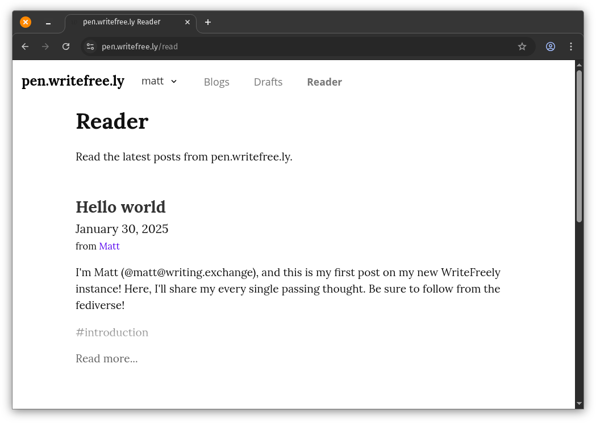

# WriteFreely

WriteFreely is a clean, Markdown-based publishing platform made for writers: start a blog, share knowledge, or build a community — with federation, so people on the fediverse can follow your blog. This repo is a one-click Railway wrapper around the official image (writefreely/writefreely v0.17.3, AGPL-3.0), with the admin account auto-seeded and data persisted on a volume.

Screenshot: upstream WriteFreely Reader view (writefreely.org).

## Source Repository

[https://github.com/INAPP-Mobile/writefreely](https://github.com/INAPP-Mobile/writefreely)

## Deploy and Host

Click **Deploy on Railway** above. The deploy form has one generated field — an admin password — and nothing else to fill in. On first boot the entrypoint creates the admin account (`admin` + your generated password) via WriteFreely's CLI; log in and write your first post.

## Why Deploy

- **Zero-field-ish deploy:** one generated secret, no wizard, no email step. The admin account is seeded automatically on first boot.
- **Real blogging, not a demo:** Markdown editor, drafts, collections, reader view, and ActivityPub federation — your blog can be followed from Mastodon and the fediverse.
- **Always-on by design:** a single Go binary with an embedded SQLite database — it boots in about a second and sips memory.
- **Persistent:** the config, SQLite database, and federation keys live on a Railway volume (`/data`) and survive redeploys.
- **Pinned upstream:** the official `ghcr.io/writefreely/writefreely:v0.17.3` image, pinned by digest — no `:latest` drift.

## Common Use Cases

- A personal blog with a clean, distraction-free reading experience.
- A team or company blog: the admin writes, readers follow via RSS or the fediverse.
- A private writing space: single-user mode with open registration off — only the admin can post.

## Configuration

| Variable | Default | What it does |
|---|---|---|
| `WRITEFREELY_ADMIN_PASSWORD` | `${{secret(16)}}` (generated) | Password for the auto-seeded admin account (`admin`). Set once on first boot; changing it later does not reset the admin password. Must not contain a colon. |
| `PORT` | Railway-injected | Mapped into the generated `config.ini` (`[server] port`) by the entrypoint on every boot. Do not set it yourself. |

All other WriteFreely settings live in the generated `config.ini` (`/data/config.ini` on the volume) and are set to sane single-user defaults at boot: `single_user = true`, `open_registration = false`, `federation = true`, `theme = write`, public host derived from `RAILWAY_PUBLIC_DOMAIN`. See the [upstream configuration docs](https://writefreely.org/docs/latest/admin/config) for the full list.

### Deployment Dependencies

- **Runtime:** single Go-binary service from the official image; boots in ~1s, runs in well under 256 MB.
- **Port:** 8080 internally, mapped from Railway's injected `PORT`.
- **Persistence:** one Railway volume mounted at `/data` (config, SQLite database `writefreely.db`, federation keys).
- **Healthcheck:** `/` (the landing page, unauthenticated, 200).
- **Plan tier:** runs on Railway's Hobby plan; no companion services.
