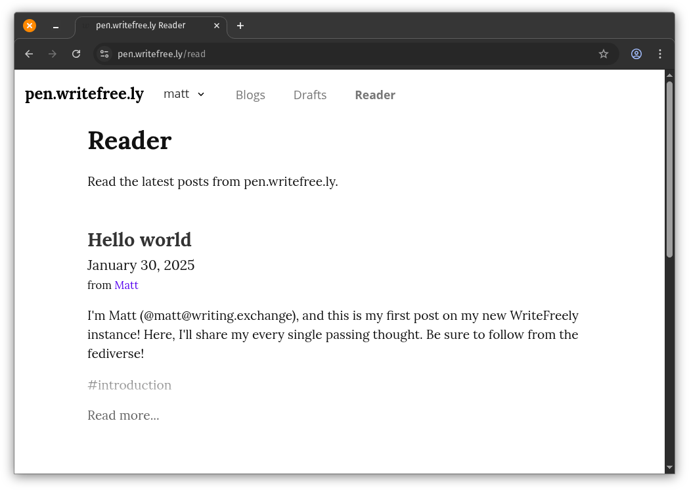

Screenshot: upstream WriteFreely Reader view (writefreely.org).

# Deploy and Host

WriteFreely is a clean, Markdown-based publishing platform made for writers: start a blog, share knowledge, or build a community — with federation, so people on the fediverse can follow your blog. One click deploys the official image (writefreely/writefreely v0.17.3, AGPL-3.0) as a single service with an embedded SQLite database. The deploy form has one generated field — an admin password — and nothing else to fill in. On first boot the admin account (`owner` + your generated password) is created automatically; log in and write your first post.

## About Hosting

WriteFreely runs as one Go-binary service from the official image, pinned by digest. The config, SQLite database, and federation keys live on a Railway volume (`/data`) and survive redeploys. The binary boots in about a second and runs in well under 256 MB, so it fits easily on the Hobby plan with no companion services. Railway's injected `PORT` is written into the generated `config.ini` on every boot, and the healthcheck is the landing page (`/`, unauthenticated).

## Why Deploy

- **Zero-fuss start:** no setup wizard to click through, no email step — the admin account is seeded on first boot.
- **Real blogging:** Markdown editor, drafts, collections, reader view, and ActivityPub federation — your blog can be followed from Mastodon and the fediverse.
- **Always-on by design:** a single Go binary with an embedded SQLite database — it stays readable the moment you open it.
- **Private by default:** single-user mode with open registration off; only the admin can post.

## Common Use Cases

- A personal blog with a clean, distraction-free reading experience.
- A team or company blog: the admin writes, readers follow via RSS or the fediverse.
- A private writing space: single-user mode with open registration off — only the admin can post.

## Dependencies for

### Deployment Dependencies

- **Runtime:** single Go-binary service; runs in well under 256 MB.
- **Port:** 8080 internally, mapped from Railway's injected `PORT`.
- **Persistence:** one Railway volume at `/data` (config, SQLite database, federation keys).
- **Healthcheck:** `/` (landing page, unauthenticated).
- **Plan tier:** Hobby plan; no companion services.

**Environment variables (condensed reference):** `WRITEFREELY_ADMIN_PASSWORD` (`${{secret(16)}}` — admin password, set once on first boot; must not contain a colon), `PORT` (injected by Railway and mapped automatically). The entrypoint writes `/data/config.ini` each boot with single-user defaults (`single_user = true`, `open_registration = false`, `federation = true`, `theme = write`) and the public host derived from `RAILWAY_PUBLIC_DOMAIN`.
